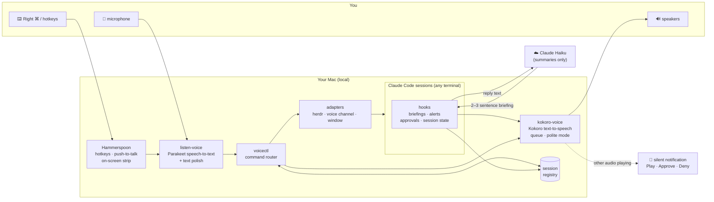

<div align="center">

# 🎙️ claude-voice-kit

**Talk to Claude Code and hear it talk back, across many agents at once.**

Spoken briefings · voice commands · hands-free approvals · local speech on your Mac

[](https://github.com/gobind-singh/claude-voice-kit/actions/workflows/ci.yml)

[](LICENSE)

</div>

---

## Why
Coding agents ask for attention all day: *finished*, *needs permission*, *here's my plan*. With several agents running,
you end up tab-hopping and reading walls of text. **claude-voice-kit** lets you *listen* instead of read, and *speak*
instead of switching windows. Speech recognition and speech generation run locally; nothing about your voice leaves your Mac.

## What you get
| | |
|---|---|
| 🔊 **Spoken briefings** | When an agent finishes, you hear a 2–3 sentence summary: *"In api. The tests pass and the PR is ready."* |
| 📝 **Plan summaries** | When Claude asks you to approve a plan, you hear what it will do and what's risky. |
| 🎙️ **Voice commands** | Hold **Right ⌘** and say *"what's happening"*, *"approve"*, *"tell docs to run the tests"*, *"switch to api"*. |
| 🎧 **Hands-free** | Say *"hey Claude, …"* with no key. Answer permission prompts out loud. Say *"stop"* to interrupt. |
| 🧭 **Multi-agent** | Every session is tracked by name. A **leader** agent can split work across worker agents. |
| 🤫 **Polite** | Music, a video or a call playing? Nothing is spoken; you get a silent notification with **Play / Approve / Deny**. |

## How it works


- **Listening:** hold Right ⌘ (or say "hey Claude"). `listen-voice` transcribes locally in about 0.1 s and polishes the
  text, then `voicectl` works out the command and acts on the right session.
- **Speaking:** Claude Code **hooks** fire when an agent finishes, needs permission or proposes a plan. A short summary
  is written by Haiku and spoken by `kokoro-voice`.
- **Reaching sessions:** through [herdr](https://herdr.dev) (full control), a local voice channel (any terminal), or by
  focusing the window.

More detail, including the design decisions, is in [docs/architecture.md](docs/architecture.md).

## Quick start
**You need:** an Apple Silicon Mac (macOS 14.2+ recommended), [Homebrew](https://brew.sh) and
[Claude Code](https://claude.com/claude-code).

```sh
git clone https://github.com/gobind-singh/claude-voice-kit.git ~/.claude-voice-kit && ~/.claude-voice-kit/install.sh
```

The installer sets up everything else: Python via `uv`, Hammerspoon, the voice model and the speech model. It's safe to
run again; running it again is also how you update. When it prints `✅ Installed.`:

1. Allow **Hammerspoon** in *System Settings → Privacy & Security → Accessibility*.
2. **Restart your Claude Code sessions.**
3. Run `voicekit doctor`. Every line should show ✅.

Then ask Claude anything and listen for the briefing, or hold **Right ⌘** and say *"what's happening"*.

## Everyday keys
| Key | Does |
|---|---|
| **Right ⌘** (hold) | speak a command |
| ⌃⌥ **F** / **N** | read the whole reply / skip to the next section |
| ⌃⌥ **R** / **S** | repeat / stop |
| ⌃⌥ **V** / **H** | voice on/off / hands-free on/off |
| ⌃⌥ **P** | play messages held during other audio |
| ⌃⌥ **K** | read the selected text in any app |

⌃ = Control, ⌥ = Option, ⌘ = Command. Every voice command, setting and troubleshooting tip is in **[docs/usage.md](docs/usage.md)**.

## Safe by design
- **No new approvals:** voice only answers prompts Claude Code already shows. Risky commands (`rm`, `git push`, `sudo`,
  …) need *"yes, approve"*.
- **Hands-free is off by default.** When it's on and you don't answer, nothing is decided and the normal prompt appears.
- **Hooks can't block Claude:** if anything in the kit fails, Claude Code carries on as normal.
- **Audit log:** every voice action is logged. The microphone is only open while you hold the key or hands-free is on.

## Privacy
| Stays on your Mac | Sent to Claude (Haiku) |
|---|---|
| your voice, speech recognition and speech generation, the session list, the audit log | the text of each reply and of each plan you're asked to approve, to write its spoken summary; commands the built-in rules don't understand |

## Dictation
For dictating messages, use **[Handy](https://handy.computer)** (free, open source). It uses the same Parakeet model,
which the kit reuses, so nothing is downloaded twice. **macOS Dictation** also works.

## Project layout
```
install.sh · uninstall.sh   one-command install / removal
bin/                        voicekit (install · doctor · status), claude-voice (voice channel launcher)
packages/kokoro-voice/      text-to-speech service + `kokoro` CLI (standalone)
packages/listen-voice/      speech-to-text service + `listen-voice` CLI (standalone)
claude/                     Claude Code layer: hooks, voicectl router, registry, adapters
hammerspoon/                hotkeys, push-to-talk, notifications
docs/                       usage, architecture, publishing, third-party licences
tests/ · scripts/           unit tests · privacy check
```

## Contributing
Issues and pull requests are welcome. See [CONTRIBUTING](.github/CONTRIBUTING.md). Run the tests with
`python3 -m unittest discover -s tests`.

## License
The code is released into the **public domain** under [The Unlicense](LICENSE): use it for anything, no attribution
needed. Models and libraries are downloaded at install time under their own licences; see
[docs/THIRD_PARTY.md](docs/THIRD_PARTY.md).
