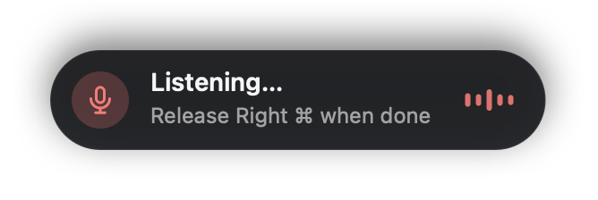
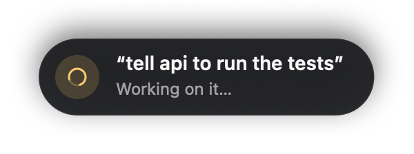
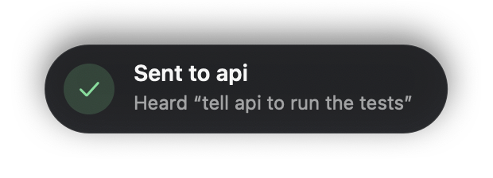
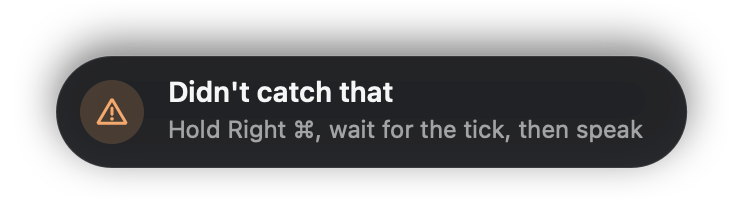
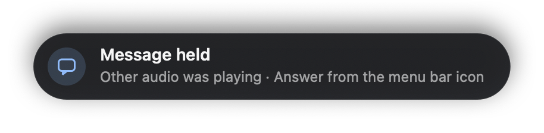
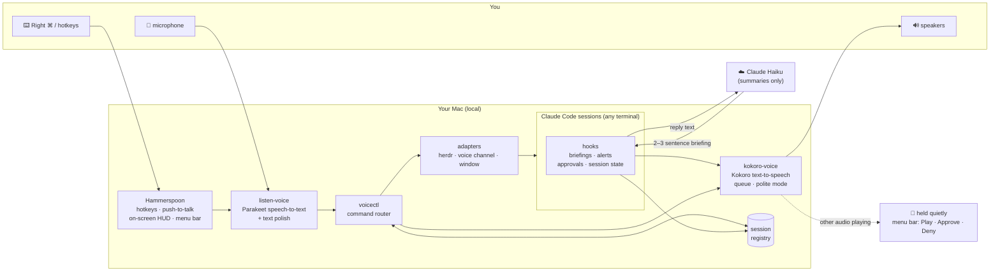

<div align="center">


# claude-voice-kit

**Talk to Claude Code and hear it talk back, across many agents at once.**

Spoken briefings · voice commands · hands-free approvals · all speech runs locally on your Mac

[](https://github.com/gobind-singh/claude-voice-kit/actions/workflows/ci.yml)

[](LICENSE)



</div>

---

## Why
Coding agents ask for your attention all day: *finished*, *needs permission*, *here's my plan*. With several agents
running, you end up tab-hopping and reading walls of text. **claude-voice-kit** lets you *listen* instead of read, and
*speak* instead of switching windows. Speech recognition and speech generation run on your Mac; your voice never leaves it.

## What you get
| | Feature | What happens |
|:-:|---|---|
|  | **Spoken briefings** | When an agent finishes, you hear 2–3 sentences: *"In api. The tests pass and the PR is ready."* |
|  | **Plan summaries** | When Claude asks you to approve a plan, you hear what it will do and what's risky. |
|  | **Voice commands** | Hold **Right ⌘** and say *"what's happening"*, *"approve"*, *"tell docs to run the tests"*, *"switch to api"*. |
|  | **Hands-free** | Say *"hey Claude, …"* without touching a key. Answer permission prompts out loud. Say *"stop"* to interrupt. |
|  | **Polite** | Music, a video or a call playing? Nothing is spoken. The menu bar icon keeps the messages for later, each with **Play / Approve / Deny**. |
|  | **Multi-agent** | Every session is tracked by name. A **leader** agent can split work across worker agents. |

## Using it, in 3 steps
**1. Hold Right ⌘.** After a soft tick, the red *Listening…* pop-up (shown at the top) appears. Say what you want, then
let go.

**2. Watch the pop-up.** It shows what it heard, then sends it to the right agent.




**3. Listen.** When the agent finishes or needs you, you hear a short summary. To answer a permission prompt, say
*"approve"* or *"deny"*. In hands-free mode, Claude asks you out loud.

### What the pop-up colours mean
The pop-up sits at the bottom of the screen, floats above every app, lets clicks pass through and fades away by itself.

| | Colour | Meaning |
|---|---|---|
|  | 🔴 red | listening to you |
|  | 🟠 amber | working on it |
|  | 🟢 green | done |
|  | 🟧 orange | something went wrong, with a hint |
|  | 🔵 blue | information, e.g. a message was held |

## The menu bar icon
The icon shows Claude's voice state at a glance. Click it for everything else.

|  |  |  |  |
|:-:|:-:|:-:|:-:|
| voice on | voice off | hands-free on | 2 messages held |

<p align="center">
  
  
</p>

From the menu you can:
- turn **Claude voice** and **Hands-free** on or off
- play, approve, deny or dismiss **held messages** (each one is a submenu)
- read the last reply in full, replay it, or stop speaking
- pick a **Voice** (you hear a short sample) and a **Speed**
- change any **keyboard shortcut**: choose it, then press the new keys

## Quick start
**You need:** an Apple Silicon Mac (macOS 14.2+ recommended), [Homebrew](https://brew.sh) and
[Claude Code](https://claude.com/claude-code).

```sh
git clone https://github.com/gobind-singh/claude-voice-kit.git ~/.claude-voice-kit && ~/.claude-voice-kit/install.sh
```

The installer sets up everything else: Python via `uv`, Hammerspoon, the voice model and the speech model. You can
run it again safely, and running it again is how you update. When it prints `✅ Installed.`:

1. Allow **Hammerspoon** in *System Settings → Privacy & Security → Accessibility*.
2. **Restart your Claude Code sessions.**
3. Run `voicekit doctor`. Every line should show ✅.

Then ask Claude anything and listen for the briefing, or hold **Right ⌘** and say *"what's happening"*.

## Everyday keys
| Key | Does |
|---|---|
| **Right ⌘** (hold) | speak a command after the tick; quick shortcuts like Right ⌘ + Delete are left alone |
| ⌃⌥ **F** / **N** | read the whole reply / skip to the next section |
| ⌃⌥ **R** / **S** | repeat / stop (**fn** also stops) |
| ⌃⌥ **V** / **H** | voice on/off / hands-free on/off |
| ⌃⌥ **P** | play messages held during other audio |
| ⌃⌥ **K** | read the selected text in any app |

⌃ = Control, ⌥ = Option, ⌘ = Command. Change any shortcut from the menu bar icon or with `voicekit keys`. Every
voice command, setting and troubleshooting tip is in **[docs/usage.md](docs/usage.md)**.

## Safe by design
- **No new approvals:** voice only answers prompts Claude Code already shows. Risky commands (`rm`, `git push`, `sudo`,
  …) need *"yes, approve"*.
- **Hands-free is off by default.** When it's on and you don't answer, nothing is decided and the normal prompt appears.
- **Hooks can't block Claude:** if anything in the kit fails, Claude Code carries on as normal.
- **Audit log:** every voice action is logged. The microphone is only open while you hold the key or hands-free is on.

## Privacy
| Stays on your Mac | Sent to Claude (Haiku) |
|---|---|
| your voice, speech recognition and speech generation, the session list, the audit log | the text of each reply and of each plan you're asked to approve, to write its spoken summary; commands the built-in rules don't understand |

## How it works


- **Listening:** hold Right ⌘ (or say "hey Claude"). `listen-voice` transcribes on your Mac in about 0.1 s and tidies
  the text, then `voicectl` works out the command and acts on the right session.
- **Speaking:** Claude Code **hooks** fire when an agent finishes, needs permission or proposes a plan. Haiku writes a
  short summary and `kokoro-voice` speaks it.
- **Reaching sessions:** through [herdr](https://herdr.dev) (full control), a local voice channel (any terminal), or by
  focusing the window.

More detail, including the design decisions, is in [docs/architecture.md](docs/architecture.md).

## Dictation
For dictating messages, use **[Handy](https://handy.computer)** (free, open source). It uses the same Parakeet model,
which the kit reuses, so nothing is downloaded twice. **macOS Dictation** also works.

## Project layout
```
install.sh · uninstall.sh   one-command install / removal
bin/                        voicekit (install · doctor · status · keys), claude-voice (voice channel launcher)
packages/kokoro-voice/      text-to-speech service + `kokoro` CLI (standalone)
packages/listen-voice/      speech-to-text service + `listen-voice` CLI (standalone)
claude/                     Claude Code layer: hooks, voicectl router, registry, adapters
hammerspoon/                hotkeys, push-to-talk, on-screen HUD, menu bar icon, line icons
docs/                       usage, architecture, publishing, third-party licences
docs/images/                logo, icons and screenshots (regenerate with scripts/readme-images.sh)
tests/ · scripts/           unit tests · privacy check · image capture
```

## Contributing
Issues and pull requests are welcome. See [CONTRIBUTING](.github/CONTRIBUTING.md). Run the tests with
`python3 -m unittest discover -s tests`.

## License
The code is released under the [MIT License](LICENSE). You can use, change and share it freely, including
commercially, as long as the licence notice stays with it. Models and libraries are downloaded at install time under
their own licences; see [docs/THIRD_PARTY.md](docs/THIRD_PARTY.md).
