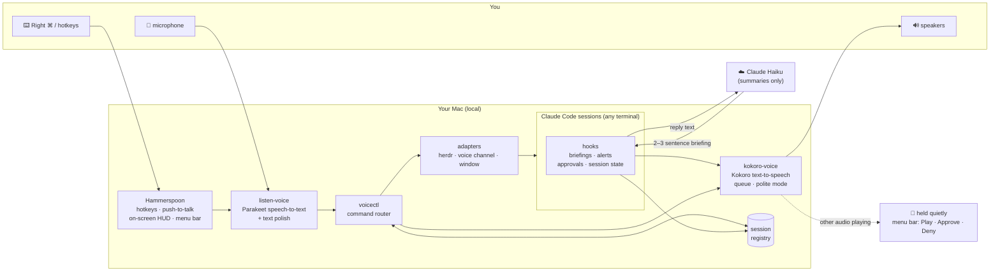
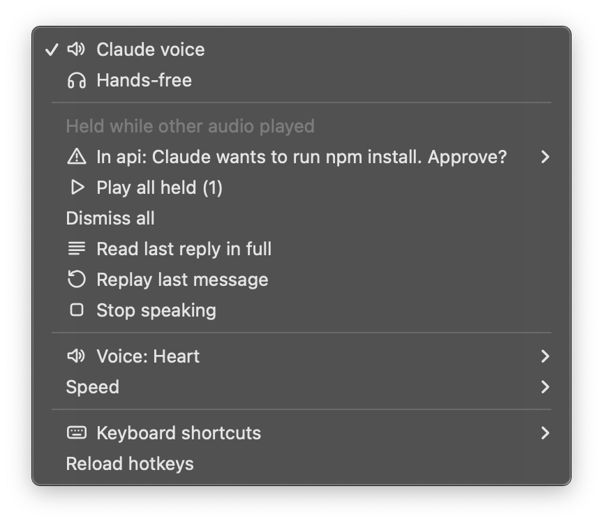

<div align="center">


# claude-voice-kit

**Talk to Claude Code and hear it talk back, across many agents at once.**

[](https://github.com/gobind-singh/claude-voice-kit/actions/workflows/ci.yml)

[](LICENSE)

</div>

---

claude-voice-kit lets you run Claude Code by voice. When an agent finishes, needs permission or proposes a plan, you
hear a short spoken summary instead of reading a wall of text. Hold a key, or say *"hey Claude"*, to check on agents,
approve requests or send instructions without switching windows. Speech recognition and the voice run on your Mac.

## How it works


Sessions are reached through [herdr](https://herdr.dev) (full control), a local voice channel (any terminal), or by
focusing the window.

## Install
**You need:** an Apple Silicon Mac (macOS 14.2+ recommended), [Homebrew](https://brew.sh) and
[Claude Code](https://claude.com/claude-code).

```sh
git clone https://github.com/gobind-singh/claude-voice-kit.git ~/.claude-voice-kit && ~/.claude-voice-kit/install.sh
```

The installer sets up the rest (Python via `uv`, Hammerspoon, both speech models). Run it again to update. When it
prints `✅ Installed.`:

1. Allow **Hammerspoon** in *System Settings → Privacy & Security → Accessibility*.
2. **Restart your Claude Code sessions.**
3. Run `voicekit doctor`. Every line should show ✅.

## What you get
| | Feature | What happens |
|:-:|---|---|
|  | **Spoken briefings** | When an agent finishes, you hear 2–3 sentences: *"In api. The tests pass and the PR is ready."* |
|  | **Plan summaries** | When Claude asks you to approve a plan, you hear what it will do and what's risky. |
|  | **Voice commands** | Hold **Right ⌘** and say *"what's happening"*, *"approve"*, *"tell docs to run the tests"*, *"switch to api"*. |
|  | **Hands-free** | Say *"hey Claude, …"* without touching a key, and answer approvals out loud. Say *"stop"* to interrupt. |
|  | **Polite** | Music, a video or a call playing? Nothing is spoken. The menu bar icon keeps the messages for later, each with **Play / Approve / Deny**. |
|  | **Multi-agent** | Every session is tracked by name. A **leader** agent can split work across worker agents. |

## Using it
**1. Hold Right ⌘.** After a soft tick, a red *Listening…* pop-up appears. Say what you want, then
let go.

**2. Watch the pop-up.** It shows what it heard, then sends it to the right agent.


**3. Listen.** When the agent finishes or needs you, you hear a short summary. Answer a permission prompt with
*"approve"* or *"deny"*.

Pop-up colours: red = listening, amber = working, green = done, orange = problem, blue = info.

### Keys
| Key | Does |
|---|---|
| **Right ⌘** (hold) | speak a command after the tick; quick shortcuts like Right ⌘ + Delete are left alone |
| ⌃⌥ **F** / **N** | read the whole reply / skip to the next section |
| ⌃⌥ **R** / **S** | repeat / stop (**fn** also stops) |
| ⌃⌥ **V** / **H** | voice on/off / hands-free on/off |
| ⌃⌥ **P** | play messages held during other audio |
| ⌃⌥ **K** | read the selected text in any app |

⌃ = Control, ⌥ = Option, ⌘ = Command. Change any shortcut from the menu bar icon or with `voicekit keys`.

## Menu bar
|  |  |  |  |
|:-:|:-:|:-:|:-:|
| voice on | voice off | hands-free on | 2 messages held |

<p align="center">
  
  
</p>

Each held message is a submenu with Play, Approve / Deny and Dismiss. Choose a shortcut to change it, then press the new keys.

## Safe and private
- **No new approvals.** Voice only answers prompts Claude Code already shows. Risky commands (`rm`, `git push`,
  `sudo`, …) need *"yes, approve"*.
- **Hands-free is off by default.** If you don't answer, nothing is decided and the normal prompt appears.
- **Never in the way.** If anything in the kit fails, Claude Code carries on as normal.
- **Microphone** is open only while you hold the key or hands-free is on. Every voice action is logged.
- **Stays on your Mac:** your voice, speech recognition and speech generation, the session list, the audit log.
  **Sent to Claude Haiku:** the text of replies and plans (to write the spoken summary), and commands the built-in rules
  don't understand.

---

**More:** every command, setting and fix is in [docs/usage.md](docs/usage.md) · design in
[docs/architecture.md](docs/architecture.md) · contributions welcome, see [CONTRIBUTING](.github/CONTRIBUTING.md).

**License:** [MIT](LICENSE). Models and libraries are downloaded at install time under their own licences
([docs/THIRD_PARTY.md](docs/THIRD_PARTY.md)).
